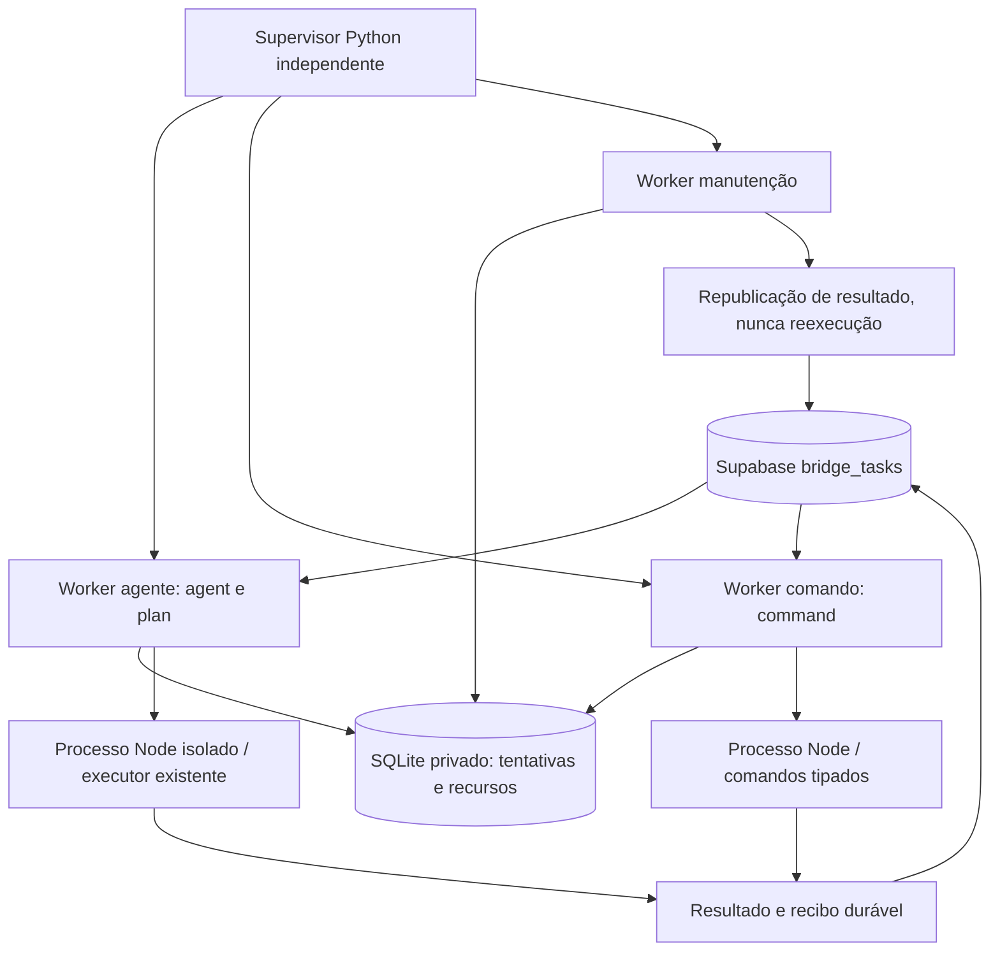

# Runtime multiexecutor: implementação opt-in, sem implantação em produção

O supervisor é o coordenador. Ele mantém trabalhadores separados para agentes,
comandos e manutenção. A manutenção continua disponível quando um agente demora.
Um processo parado ou uma tarefa marcada concluída não provam que uma ação no
mundo real aconteceu. Resultado, recibo e efeito precisam ser distinguidos.

## Componentes e responsabilidade



| Componente | Arquivo | Responsabilidade |
|---|---|---|
| Supervisor | `runtime/service.py supervisor` | Singleton, sessões independentes, orçamento de restart, draining/ACK |
| Worker agente | `runtime/service.py agent` | Seleção FIFO de agent/plan, reserva antes do claim, adapter legado |
| Worker comando | `runtime/service.py command` | Seleção FIFO de command, execução literal existente |
| Manutenção | `runtime/service.py maintenance` | Saúde, running sem recibo local, resultados pendentes, quarentena |
| Registro durável | `runtime/ledger.py` | Transações SQLite, unicidade por tarefa/recurso, fencing, controles/auditoria |
| Transporte | `runtime/queue.py` | Consulta e PATCH condicional queued → running, sem migrations |
| Processo executor | `runtime/execute.cjs` | Progresso, resultado antes da publicação, integração com TTS/metadados/task-git existentes |

## Concorrência e limites concretos

Este runtime é **single-host**. SQLite não é um lock distribuído entre celulares.
É proibido ativar outro host consumidor ou o worker legado em paralelo. O supervisor
recusa iniciar enquanto encontrar o worker OU launcher antigo, e drena seus workers
se detectar retorno do legado. Essa detecção não substitui a transição operacional.

A reserva local usa `BEGIN IMMEDIATE`: todos os recursos são reservados juntos ou
nenhum é. Não há espera mantendo um subconjunto de locks, evitando deadlock de ordem.
Cada tentativa recebe token aleatório; gravações com token antigo são recusadas.
O claim remoto permanece compare-and-set `status=queued`, com retorno da linha.
Erro de rede após claim é resultado incerto, não licença para retry de execução.

Resources: workspace canônico, `device:adb` global e `artifact:apk103`. Todos os
endereços ADB compartilham o recurso, pois IPs diferentes podem apontar ao mesmo carro.
Agentes podem usar ferramentas: por prudência reservam todos esses recursos. Assim,
**neste projeto único, agente e ação ADB não executam simultaneamente**. Os processos
são independentes, manutenção é concorrente, e o coordenador permite paralelismo
quando os conjuntos são disjuntos. Não prometemos isolamento de capacidades do mesmo
UID nem paralelismo irrestrito. Separar workspaces/providers com ACL mais fina é etapa
posterior; não foi criado um bypass para aumentar concorrência.

Locks `.bridge-workspace-lock` legados permanecem intactos. PID morto, idade ou boot
novo nunca removem lock nem reexecutam tarefa. Tarefas terminais no registro não podem
ser reivindicadas novamente, nem com o mesmo UUID após reboot.

## Recuperação e validação de efeitos

1. `reserved` é persistido antes do claim; `executing` antes de spawn.
2. O executor grava `result.json` antes de publicar. O worker existente cria seu
   recibo sanitizado antes do PATCH e verifica status/result/error por leitura.
3. Recursos só são liberados com processo ausente **e** publicação confirmada
   **e** `workspaceReleased=true`. Ambos são necessários.
4. Falha entre spawn e gravação do PID conserva o fence. PID inclui início em
   `/proc` e boot ID para evitar confusão por reutilização.
5. Manutenção pode executar apenas `publish`, usando resultado persistido. Não
   chama novamente Codex, shell, install ou comandos ADB para obter resultado.
6. Sem resultado conclusivo, estado local `uncertain`: dados e locks retidos.
   O status remoto `running` não é automaticamente mudado nem reencaminhado.
7. Heartbeats atrasados geram diagnóstico; não são prova de morte/efeito ausente.
   Um Codex remoto pode sobreviver ao processo local. Não cancelar/repetir cegamente.

`health.json` lista running sem recibo local (até 100 linhas, sem instruções/resultados).
Para tarefa histórica: ler resultado, recibos e estado do executor; classificar o
que foi apenas resposta textual; validar efeito por meio passivo autorizado numa
atividade separada; registrar decisão. Não apagar histórico nem resetar `running`
para `queued` para forçar execução. Este runtime não reconcilia automaticamente
386/387/390 nem instala APK para diagnosticar.

## Saúde, draining e reinício cruzado

Workers registram PID, boot/início, estado e heartbeat durante execução do filho.
Filho grava `executor-health.json` a cada 2 segundos. Manutenção aponta worker com
heartbeat >15s e executor >60s como suspeitos. O watchdog observa, não mata operações
incertas. Supervisor tem no máximo três partidas por lane/hora, com backoff 2/4s
antes de atingir o limite; orçamento persiste após reinício/reboot.

O comando textual legado `bridge_control` é recusado explicitamente neste runtime
(não retorna falso sucesso). A autorização de controle v2 é local pelo UID e diretório
privado; não foi publicado um endpoint remoto novo.

Controles locais privados: `status`, `drain`, `restart`; não aceitam shell ou PIDs
arbitrários. `restart` pede draining; o worker termina a tarefa, publica resultado e
marca `drained`. Só então o supervisor envia SIGTERM ao worker ocioso e espera a
identidade anterior desaparecer antes de iniciar outro. ACK exige heartbeat idle
do novo worker. Nenhum SIGKILL, remoção forçada de lock ou restart da própria tarefa.
Um worker morto pode ser reposto; o journal impede retomar seus efeitos incertos.

## Configuração e implantação (NÃO realizada nesta tarefa)

Pré-requisitos: Python 3 com sqlite3/fcntl, Node, dependências já usadas pelo projeto,
credencial privada existente, schema com execution_mode, apenas um host consumidor.
Não há tmux obrigatório: `start_new_session=True` desacopla cada worker/executor.
Tmux pode envolver somente o supervisor para observação, não criar workers extras.

1. Rodar suíte e revisar branch; fazer snapshot privado de configurações/recibos.
2. Confirmar fila e executores sem atividade incerta; drenar legado via seu protocolo
   instalado após publicação da tarefa atual. Desabilitar apenas seu autostart no
   momento autorizado. Não fazer isso durante esta implementação.
3. Preservar todos os receipts/locks legados para inspeção. Resolver bloqueios por
   evidência, nunca apagando por idade. Confirmar worker e supervisor legados ausentes.
4. Criar diretório `~/.config/codex-bridge/runtime-v2` 0700. Somente proprietário
   provisiona `activation.json` 0600 com
   `{"enabled":true,"single_host":true,"legacy_drained":true}` após as verificações.
5. Iniciar uma única sessão:

```sh
cd ~/codex-bridge
python3 -B -m runtime.service supervisor --state "$HOME/.config/codex-bridge/runtime-v2"
```

Para terminal desacoplado, pode usar `tmux new-session -s bridge-runtime` e executar
esse mesmo comando dentro. Não instalar tmux automaticamente nem aninhar supervisores.
Para reboot autorizado, instalar `runtime/20-bridge-runtime` no Termux:Boot somente
após desativar o boot legado. A presença de activation.json não prova cutover seguro;
o próprio processo também confere legado e singleton. Android pode matar todos os
processos: reboot/autostart não garantem conclusão; o journal conserva incerteza.

## Operação e autorização

Os comandos abaixo atuam somente no runtime v2, não no worker em produção legado:

```sh
python3 -B -m runtime.service status --state "$HOME/.config/codex-bridge/runtime-v2"
python3 -B -m runtime.service control --state "$HOME/.config/codex-bridge/runtime-v2" --lane command --action drain
python3 -B -m runtime.service control --state "$HOME/.config/codex-bridge/runtime-v2" --lane command --action restart
```

Somente o UID proprietário acessa estado 0700/arquivos 0600. Não há endpoint público
ou concessão RLS adicional. Tokens de fila ficam fora do repo/modelo. Controles locais
não concedem permissão automotiva; as políticas do executor tipado permanecem.
Logs privados por lane e tarefa; não publicar result.json, task.json, SQLite, tokens
ou capturas. Auditoria é preservada; retenção/exportação privada requer política do
operador (não há exclusão automática nesta etapa).

## Rollback

Solicitar drain das três lanes, aguardar ACK/ausência de executores e resultados
publicados, parar apenas supervisor já ocioso, preservar todo o estado. Desabilitar
boot v2 e activation.json por alteração autorizada; restaurar autostart legado só
após confirmar nenhum worker v2 ou executor remanescente. Recibos v2 pendentes exigem
reconciliação antes de retomar consumo legado. Não renomear/apagar locks para liberar.

## Troubleshooting

- **Legacy active:** transição não concluída; não force outra instância.
- **uncertain/running antigo:** inspecionar recibos, thread remota e efeito; não retry.
- **Sem capacidade:** verificar recursos retidos; estados incertos bloqueiam de propósito.
- **Sem ACK:** worker ocupado/publicação pendente ou PID antigo ainda vivo; aguardar/investigar.
- **Crash-loop:** consultar restart-budget.json; não apagar para reiniciar em loop.
- **Fila indisponível:** timeout de API; não repetir uma operação por ausência de resposta.
- **Processo vivo sem heartbeat:** suspeita de travamento, não prova de cancelamento.

## Testes e evidências

```sh
python3 -B tests/test_runtime.py
npm test
npm run dashboard:build
git diff --check
```

Testes isolados usam SQLite temporário, concorrentes reais, crash via os._exit,
identidade de processo, publicação mockada e supervisor com três subprocessos fake.
Nenhum acessa o veículo ou reinicia produção. Cobrem reserva atômica, recursos
disjuntos, fencing, replay, reboot, impossibilidade de liberar incerteza, CAS remoto,
ACK/restart de apenas uma lane e conservação das demais. A suíte existente mantém
regressões de publicação, cancelamento, providers, TTS, locks e comandos.
Evidência prévia: tarefa 390 terminou `succeeded`, mas seu resultado disse que nenhum
comando foi executado. Não é evidência de instalação. Esta tarefa é infraestrutura.

Na leitura desta implementação, a tarefa 387 estava failed com “Workspace ocupado ou com execução incerta. Nenhum executor iniciado.” A consulta por task_number=386 não retornou linha; a ausência não prova remoção nem execução. Nenhum estado foi alterado.

### Evidência da validação local desta entrega

Em 2026-10-11: `npm test` terminou com `OFFLINE SUITE PASSED`, 414 testes Node
aprovados e 11 testes Python do runtime, além das suítes Python existentes.
`npm run dashboard:build`, verificações de sintaxe e `git diff --check` passaram.
Não houve implantação, alteração de fila, operação ADB nem restart da produção.
Os testes de crash/reboot são simulações locais com processos descartáveis; não
foi reiniciado Android/Termux nem provada recuperação de uma thread Codex real travada.

## Atividade e revisão incremental

Veja [Atividade e recuperação](ACTIVITY-RECOVERY.md) para limites, monitor, timeout por inatividade e pendências de homologação.
